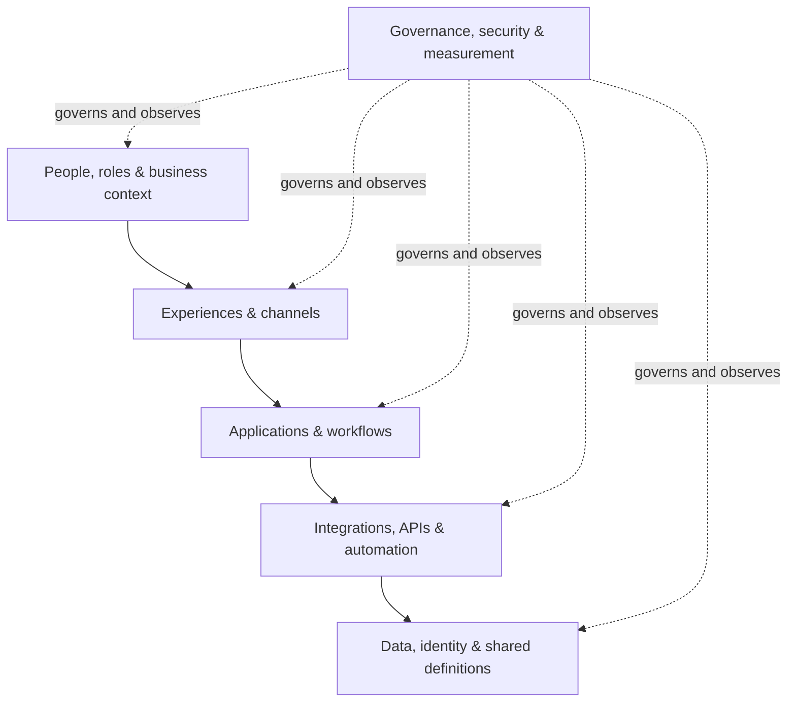

# Marcel Baillargeon

### Systems architect | Revenue operations | Data & automation | AI-enabled operations

**I design durable systems that help people make better decisions and do meaningful work with less friction.**

[LinkedIn](https://www.linkedin.com/in/marcel-rev-ops) · [GitHub projects](https://github.com/marcelivan?tab=repositories)

---

## How I think about systems

Most operational problems do not live inside one application. They live between people, processes, data, decisions, and technology.

My work is to make those relationships visible, understandable, and dependable: connect fragmented environments, clarify ownership, improve the quality of information, and build operating models that teams can maintain without relying on one person to hold everything together.

I approach architecture as a form of stewardship: create the conditions for agency, development, belonging, and choice without turning the system into a source of control.

## Areas of practice

| Area | What I work to make possible |
| --- | --- |
| **Systems architecture** | Clear boundaries, relationships, ownership, dependencies, and change paths |
| **Revenue operations** | Connected CRM, marketing, service, lifecycle, and business processes |
| **Data architecture & governance** | Trusted definitions, lineage, identity, quality, access, and accountable ownership |
| **Integration & automation** | Reliable APIs, event-driven workflows, orchestration, and useful exception handling |
| **AI-enabled operations** | Human-directed AI workflows with clear permissions, evidence, review, and recovery |
| **Operational design** | Observable systems, repeatable practices, maintainable documentation, and independent operators |

## A systems view

I use a layered model to reason about complex operating environments. The specific tools change; the relationships and controls deserve deliberate design.

The goal is not complexity for its own sake. It is a system that can be understood, operated, tested, repaired, and improved.

## Selected public projects

These are public experiments and tools. They illustrate areas of exploration; they should not be read as claims of enterprise deployment or measured business outcomes.

- **[Tend](https://github.com/marcelivan/tend)**
  A behavioral reflection and planning concept exploring how structured feedback can support more intentional habits.

- **[NeuroPilot](https://github.com/marcelivan/NeuroPilot)**
  A guided daily reflection and planning application concept, with a focus on simple rituals and low-friction interaction.

- **[Claude quota proxy](https://github.com/marcelivan/claude-quota-proxy)**
  A lightweight local proxy that captures rate-limit information and makes usage state available to Claude Code.

- **[Humanizer](https://github.com/marcelivan/humanizer)**
  A writing-quality skill for reviewing generic AI phrasing and bringing drafts closer to a natural human voice.

## Principles I bring to the work

- **People before process.** Systems should serve the people who use and depend on them.
- **Truth before dashboards.** Definitions, lineage, and data quality come before confident reporting.
- **Ownership with authority.** Responsibility needs clear decision rights and support.
- **Evidence before claims.** A successful build, passing test, or merged change is not proof of adoption or business impact.
- **Reversibility before lock-in.** Prefer bounded experiments, clear failure signals, and recoverable change.
- **Complexity in the architecture, simplicity in the operation.** Make the safe path the easy path.
- **Stewardship without control.** Build environments that others can understand, operate, and improve.

## How I approach change

**Observe → Name → Model → Test → Measure → Revise → Simplify**

I look for the real source of friction, make assumptions explicit, map the relationships, test the smallest complete intervention, and use evidence to decide what should change next. When a system stops serving its purpose, adapt it or retire it.

## Connect

I welcome thoughtful conversations about systems architecture, revenue operations, data governance, responsible automation, AI-enabled workflows, and the human side of operational design.

**[Connect on LinkedIn](https://www.linkedin.com/in/marcel-rev-ops)** · **[Explore public repositories](https://github.com/marcelivan?tab=repositories)**

---

Public profile and portfolio. Employer-confidential architecture, customer or employee information, internal system details, credentials, and non-public implementation evidence are intentionally excluded.
